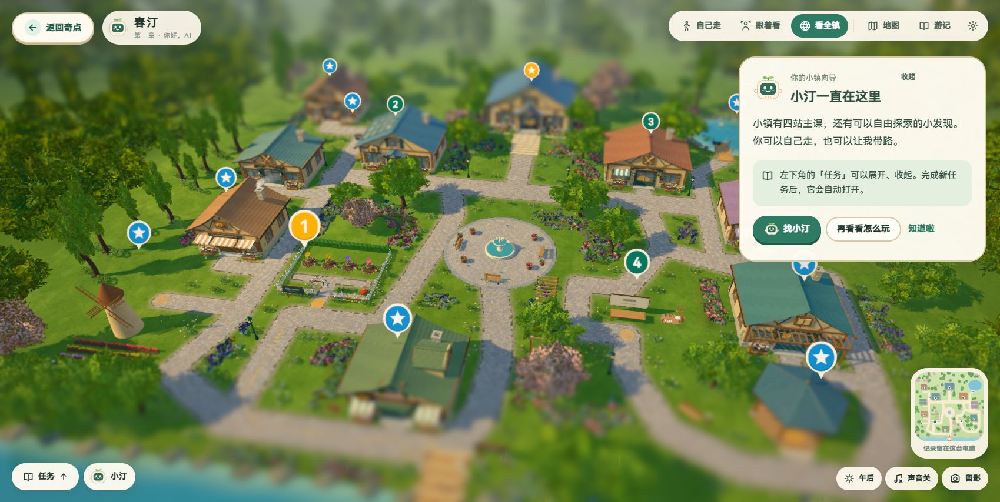
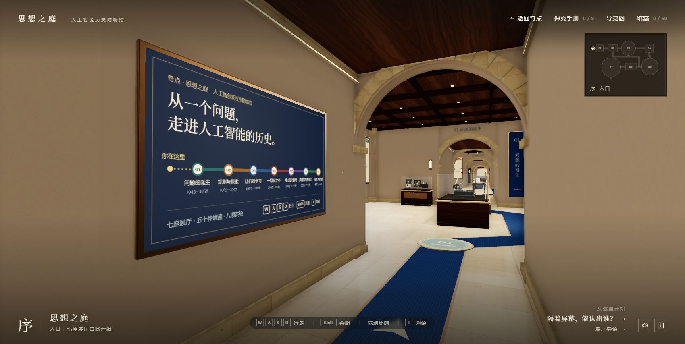
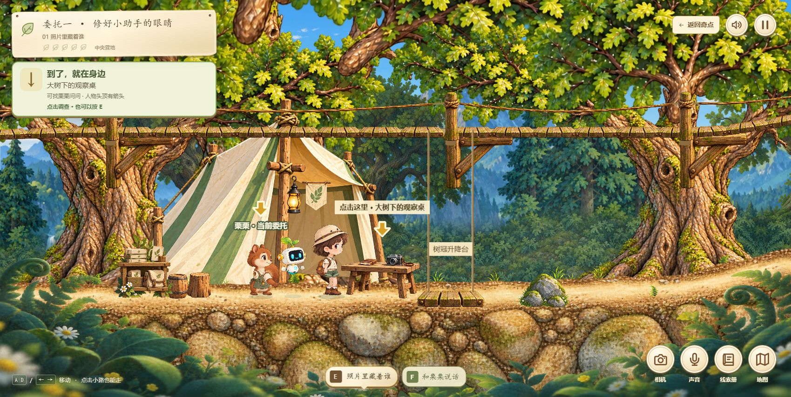
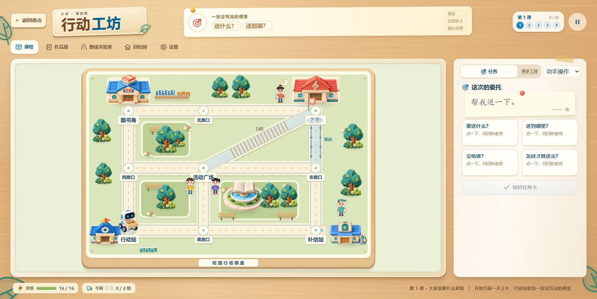
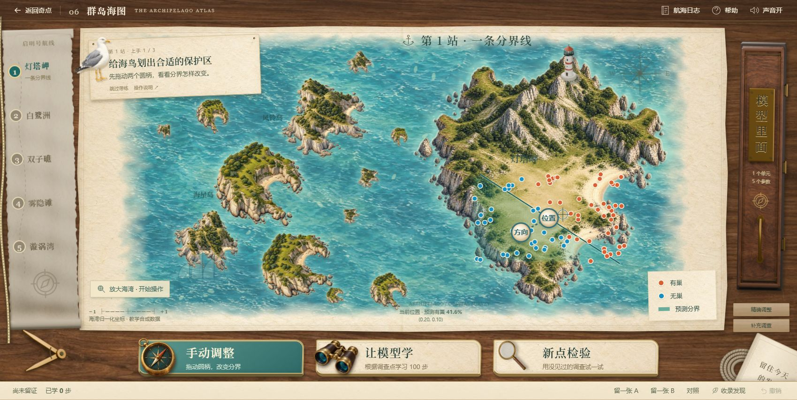
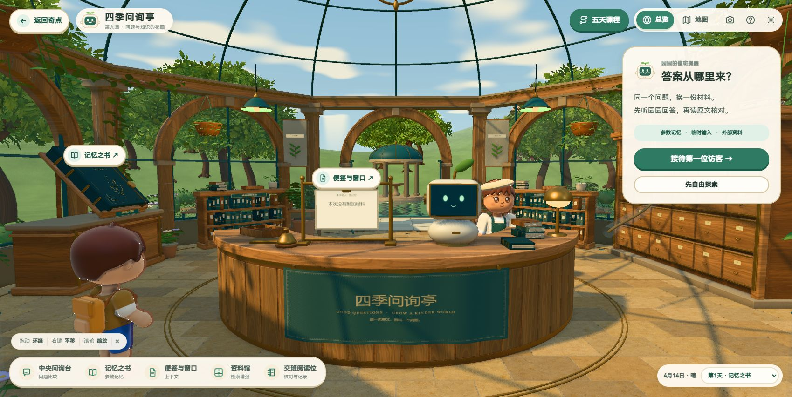
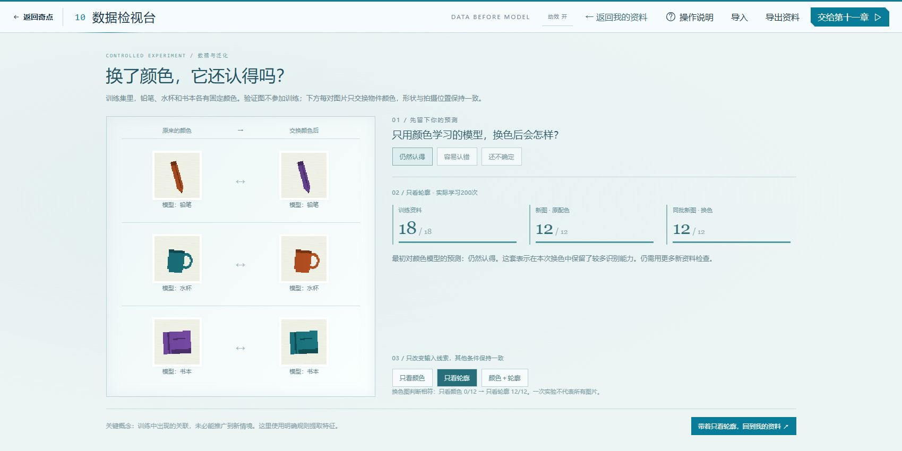
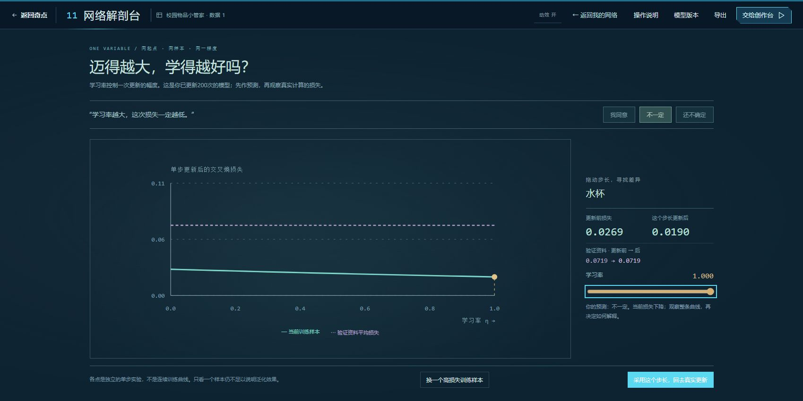
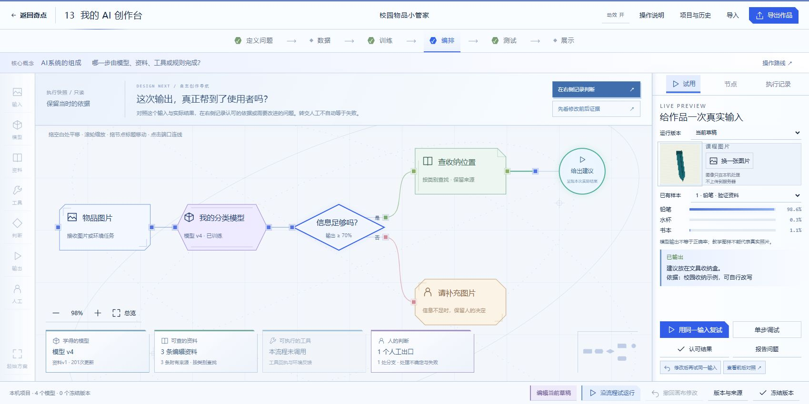

<p align="center">
  <a href="https://falling-feather.github.io/nova/"></a>
</p>

<h1 align="center">奇点——交互式通识教学网站</h1>

<p align="center"><strong>在交互中理解，在探索中学习，在创作中检验。</strong></p>
<p align="center">面向中小学人工智能通识教育的数字交互资源</p>

<p align="center">
  <a href="#课程画廊"></a>
  <a href="#核心概念"></a>
  <a href="https://falling-feather.github.io/nova/"></a>
  <a href="#快速开始"></a>
  <br>
  <a href="package.json"></a>
  <a href="#技术与工程"></a>
  <a href="#技术与工程"></a>
  <a href="#技术与工程"></a>
</p>

<p align="center">
  <a href="https://falling-feather.github.io/nova/"><strong>在线体验</strong></a> ·
  <a href="https://falling-feather.github.io/nova/courses/">课程目录</a> ·
  <a href="#课程画廊">十三章实机</a> ·
  <a href="#快速开始">本地运行</a> ·
  <a href="docs/deployment.md">部署指南</a> ·
  <a href="https://github.com/falling-feather/nova/issues">问题反馈</a>
</p>

[](https://falling-feather.github.io/nova/)

## 项目简介

奇点把十三章 AI 通识课程做成可以走进去、动手试、反复比较的学习场景。从小镇与博物馆出发，经过海图、印书局和沙画工作台，最后亲自整理数据、训练模型、编排流程，完成一件可以试用的 AI 作品。

课程沿着 **发现智能 → 理解机制 → 动手创造** 递进，也可以切换到“按概念”目录，围绕同一个问题跨章探索。每章的美术与交互服务于具体学习任务：拖动分界线看模型变化，替换词语看上下文作用，改变随机种子比较生成结果，用实际回执核对行动是否完成。

> **体验方式**：使用桌面 Chrome 或 Edge，开启硬件加速。在线站点无需安装、登录或配置模型 API Key；模型文件首次加载需要一些时间。

## 核心概念

| 概念方向 | 学生要追问的问题 | 主要章节 |
| --- | --- | --- |
| **学习与泛化** | 学会了，还是只记住了？换一批没见过的材料，还能判断吗？ | 03、05、06、10、11 |
| **上下文与表示** | 同一个词、同一个问题，换一种线索为什么会改变输出？ | 07、09 |
| **条件与生成** | 从随机起点到新内容，条件和采样过程各起什么作用？ | 07、08 |
| **工具与反馈** | 发出指令就等于完成了吗？怎样观察、核验、停止或求助？ | 04、12、13 |

第一、二章提供生活经验与历史背景，后续章节通过实际操作反复使用这些概念。[进入概念目录 →](https://falling-feather.github.io/nova/courses/?mode=concepts)

## 课程画廊

以下均为项目实机画面。点击图片进入对应课程；截图中的操作记录仅用于演示。

### 第一阶段 · 发现智能

#### 01 · 春汀小镇

[](https://falling-feather.github.io/nova/chapters/01/)

**我们身边的 AI，究竟能做些什么？** 和小汀在三维小镇自由行走，拍花核对识图结果、辨别自动化与 AI、检查通知，再一起画画。把照片、作品和自己的判断带进小镇游记。

`生活应用` `结果核对` `人机共创` · [进入小镇](https://falling-feather.github.io/nova/chapters/01/)

#### 02 · 思想之庭

[](https://falling-feather.github.io/nova/chapters/02/)

**AI 是怎样一步步走到今天的？** 沿七座相连展厅自由参观，靠近展品阅读有来源的史料，动手尝试各厅实验。把历史转折与技术的能力、局限放在一起理解。

`AI 历史` `规则与学习` `能力与局限` · [进入展厅](https://falling-feather.github.io/nova/chapters/02/)

#### 03 · 森语奇旅

[](https://falling-feather.github.io/nova/chapters/03/)

**同一片叶子，换一个角度还认得吗？** 在二维森林中走访观察站，采集和分类样本，改变光照、角度与遮挡，寻找识别失败的条件，理解特征、标签与数据多样性。

`样本与标签` `特征` `数据多样性` · [进入森林](https://falling-feather.github.io/nova/chapters/03/)

#### 04 · 行动工坊

[](https://falling-feather.github.io/nova/chapters/04/)

**一条最短的路，为什么未必能走通？** 先问清送货任务，再为校园机器人安排路线。面对封路、电量和交付条件，比较方案、解释失效原因并修改策略。

`目标与约束` `搜索与规划` `策略调整` · [进入工坊](https://falling-feather.github.io/nova/chapters/04/)

### 第二阶段 · 理解机制

#### 05 · 光影学徒

[](https://falling-feather.github.io/nova/chapters/05/)

**模型如何从一次错误中作出调整？** 在摄影社选择照片、核对标签，观察学习如何改变参数与预测；再用没学过的照片检查效果，区分训练和推理。

`参数与预测` `损失与更新` `独立检验` · [进入摄影社](https://falling-feather.github.io/nova/chapters/05/)

#### 06 · 群岛海图

[](https://falling-feather.github.io/nova/chapters/06/)

**更多的连接，真的总会更聪明吗？** 在五片海域中拖动预测分界、放大海湾、改变网络结构，让小网络根据调查点学习。用新调查检验结果，比较容量、过拟合与计算预算。

`神经网络` `模型容量` `学习与泛化` · [展开海图](https://falling-feather.github.io/nova/chapters/06/)

#### 07 · 活字印书局

[](https://falling-feather.github.io/nova/chapters/07/)

**一句话里，哪些词值得多看一眼？** 拆分句子、翻开活字的数字名牌、重排词序，再改变上下文查看真实计算。跟随候选概率逐字排印，完成自己的校庆特刊。

`词元与向量` `上下文与注意力` `自回归生成` · [进入印书局](https://falling-feather.github.io/nova/chapters/07/)

#### 08 · 潮汐沙画节

[](https://falling-feather.github.io/nova/chapters/08/)

**一团噪声，怎样逐渐成为一幅图？** 亲手画沙画、推动潮水尺加噪，再观察逐步去噪。分别改变随机种子、采样步数与题目条件，留下可复现的配方，策划自己的夜场展览。

`扩散与去噪` `随机种子` `条件生成` · [来到沙画节](https://falling-feather.github.io/nova/chapters/08/)

#### 09 · 四季问询亭

[](https://falling-feather.github.io/nova/chapters/09/)

**AI 的答案，来自记忆还是眼前的资料？** 在植物园接待游客，比较参数记忆、便签窗口和检索资料；把回答逐条对照来源，为下一位同学留下能复查的交班记录。

`参数记忆` `上下文窗口` `检索与来源核验` · [来到问询亭](https://falling-feather.github.io/nova/chapters/09/)

### 第三阶段 · 动手创造

#### 10 · 数据检视台

[](https://falling-feather.github.io/nova/chapters/10/)

**模型认的是物体，还是容易学到的颜色关联？** 导入图片、检查标签和采集条件，划分训练、验证与封存测试资料。建立线性基线，逐张追查误判，再把资料交给下一章。

`数据整理` `特征与偏差` `验证与测试` · [打开检视台](https://falling-feather.github.io/nova/chapters/10/)

#### 11 · 网络解剖台

[](https://falling-feather.github.io/nova/chapters/11/)

**学习率更大，就一定学得更好吗？** 接住自己的资料，拆开加权和、激活与梯度，完成前向计算、反向求导和真实参数更新。比较网络结构与步长，保存可调用的分类模型。

`前向与反向传播` `梯度与学习率` `模型对照` · [打开解剖台](https://falling-feather.github.io/nova/chapters/11/)

#### 12 · 行动编排台

[](https://falling-feather.github.io/nova/chapters/12/)

**发出指令，就等于完成任务了吗？** 连接传感器和行动节点，在温室模拟中读取、供水、通风并复查。对比固定工作流与目标驱动规划，加入故障，判断何时继续、停止或求助。

`工作流与规划` `工具调用` `反馈与停止` · [打开编排台](https://falling-feather.github.io/nova/chapters/12/)

#### 13 · 我的 AI 创作台

[](https://falling-feather.github.io/nova/chapters/13/)

**怎样把自己设计的能力变成可试用的作品？** 围绕一个问题，把前几章的资料、模型和行动方案接入画布。亲手接线、试用、修改，用同一输入比较版本，导出包含图片、权重、流程和记录的作品包。

`AI 系统组成` `迭代评价` `边界与责任` · [开始创作](https://falling-feather.github.io/nova/chapters/13/)

## 快速开始

准备 **Git、Node.js 24.20.0 或更新版本**及其随附的 npm，在终端执行：

```bash
git clone --branch main --single-branch https://github.com/falling-feather/nova.git
cd nova
npm ci
npm run build:site
npm start
```

打开 [本地预览](http://127.0.0.1:4173/)。`dist-site/` 是完整静态站点；修改代码后重新构建即可更新。按 `Ctrl+C` 停止本地预览。请通过 HTTP 服务访问，直接双击 HTML 无法正确加载模块、模型与工作线程。

| 需要做什么 | 命令 |
| --- | --- |
| 调试某一章 | `npm run dev -- 08` |
| 构建主站与指定章节 | `npm run build -- 08` |
| 检查项目结构 | `npm run check` |
| 运行某章已有测试 | `npm run test -- 08` |
| 运行全站已有单元检查 | `npm test` |
| 重新组装已构建的课时 | `node tools/build-site.cjs` |

## 部署

| 场景 | 交付内容 | 操作入口 |
| --- | --- | --- |
| **在线访问** | 已部署的完整课程 | [GitHub Pages](https://falling-feather.github.io/nova/) |
| **自己的静态服务器** | `npm run build:site` 生成的 `dist-site/` | [静态托管步骤](docs/deployment.md#静态服务器) |
| **GitHub Pages** | `main` 保存源码，`gh-pages` 保存构建结果 | [发布与更新步骤](docs/deployment.md#github-pages) |
| **Windows 离线或局域网展示** | 含 Node 运行时的独立包与“点我一键启动.cmd” | [导出与启动步骤](docs/deployment.md#windows-独立运行包) |

当前 Pages 使用分支发布。**提交源码不会自动重新构建网站**；发布网站需要先构建，再更新 `gh-pages`。只调整 README、截图和说明文档时，无需重发网站。

## 技术与工程

| 层次 | 实现 |
| --- | --- |
| 场景与交互 | JavaScript / TypeScript、Three.js、Phaser、Canvas 与 SVG；各章按学习任务组织独立场景 |
| 模型计算 | 第五、六、十一章实际更新模型参数；第七章运行随包微型语言模型；第八、九章以 ONNX Runtime Web / WASM 执行模型推理 |
| 创作衔接 | 第十、十一、十三章共用本机创作项目，第十二章行动方案可交给创作台 |
| 存储与交付 | localStorage / IndexedDB 保存进度与作品；纯静态托管，无业务后端、账号系统或在线大模型依赖 |
| 图片加载 | 静态插图与材质采用 WebP 网页版本；参与教学计算的照片图集保持无损，详见[图片交付说明](docs/image-delivery.md) |

```text
apps/platform/       首页、双模式课程目录与个人发现
lessons/01 … 13/     十三章源码、模型与运行素材
shared/neural/       海图课程的网络计算与实验记录
shared/creator/      数据、分类模型、流程与作品仓库
shared/linkage/      课程跳转、返回与本机存档协议
tools/               构建、静态组装、预览与 Windows 导出
docs/                部署指南、课程文档与第三方许可
```

依赖和版本以 [package.json](package.json) 与 [package-lock.json](package-lock.json) 为准。实现入口见 [开发文档](docs/README.md)，课程主题见 [课程地图](docs/课程地图.md)，素材授权见 [许可汇总](docs/licenses/)。

## 学习记录与使用说明

- 进度和作品保存在当前浏览器中，不进行账号或云同步。更换浏览器、域名或本地端口，会使用另一份记录。
- 需要迁移或保留成果时，使用相应课程的作品导出与导入功能；清理浏览器数据前先导出重要作品。
- 网络、语言和生成模型服务于明确的教学任务；温室是可操作的模拟环境。实验读数用于解释本次操作，不代表通用 AI 的能力评分。

<p align="center"><a href="https://falling-feather.github.io/nova/"><strong>从一次好奇的触碰，走近人工智能的世界。</strong></a></p>
