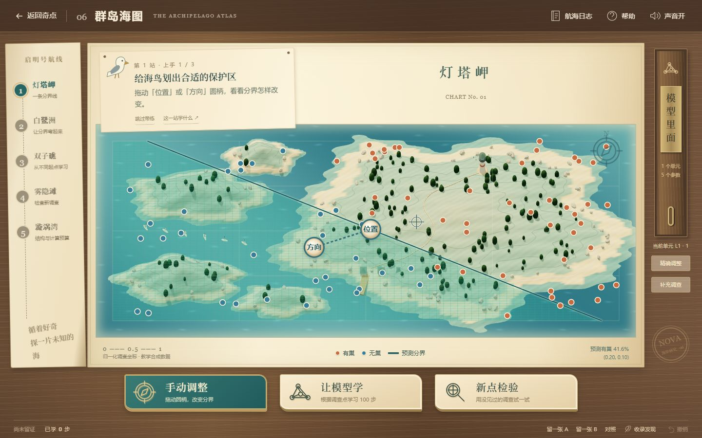

# 奇点——交互式通识教学网站

奇点是一套面向中小学人工智能通识教育的数字交互资源。十三章课程结合生活探索、二维任务、三维场景与可操作实验，让学生观察现象、改变条件、比较结果，再完成自己的 AI 系统作品。

**[在线体验](https://falling-feather.github.io/nova/)** · **[源码仓库](https://github.com/falling-feather/nova)**



## 课程与核心概念

| 阶段 | 课程 | 学习重点 |
| --- | --- | --- |
| 发现智能 | 01 春汀小镇、02 思想之庭、03 森语奇旅、04 行动工坊 | 认识生活应用、历史、识别依据与规则行动 |
| 理解机制 | 05 光影学徒、06 群岛海图、07 活字印书局、08 潮汐沙画节、09 四季问询亭 | 操作教具，比较学习、语言、生成与知识来源 |
| 动手创造 | 10 数据检视台、11 网络解剖台、12 行动编排台、13 我的 AI 创作台 | 整理数据、训练模型、调用工具、组合并检验作品 |

目录提供“按阶段”和“按概念”两种入口，进入同一套课程。四个概念方向分别是：

- **学习与泛化**：从样本中学习，并用未见材料检验。
- **上下文与表示**：改变输入线索，观察词语表示和回答如何变化。
- **条件与生成**：比较随机起点、生成条件与采样过程。
- **工具与反馈**：围绕目标调用工具，用回执和再次观测核验结果。

## 本地运行

使用 **Node.js 24.20.0 或更新版本**。建议桌面 Chrome 或 Edge，开启硬件加速。

```bash
git clone https://github.com/falling-feather/nova.git
cd nova
npm ci
npm run build:site
npm start
```

打开终端显示的地址，默认是 `http://127.0.0.1:4173/`。关闭终端或按 Ctrl+C 停止预览。静态文件位于 `dist-site/`，不要直接双击 HTML 以 `file://` 方式打开。

```bash
npm run dev -- 08          # 调试单个课时
npm run build -- 08        # 重建主站与指定课时
npm run test -- 08         # 指定课时测试
npm run check             # 检查整站结构
npm test                  # 全站单元检查
```

更改章节后，可运行 `npm run build:site` 更新完整站点。

## 工程结构

```text
apps/platform/       首页、双模式课程目录与个人发现
lessons/01 … 13/    十三个课时的代码、模型和素材
shared/neural/       群岛海图的网络计算与实验记录
shared/creator/      高中数据、分类模型、流程与作品仓库
shared/linkage/      课程跳转、公共返回与本机存档协议
tools/               构建、静态组装、预览和 Windows 导出
docs/                课程地图、实现说明及第三方许可
```

依赖由根目录的 `package.json` 和锁文件统一管理。源代码分支不包含 `node_modules`、浏览器记录、临时测试目录或站点构建产物。

## 实现特点

- JavaScript / TypeScript、Three.js、Phaser、Canvas 与 SVG 承担不同课程的交互呈现。
- 第五、六、十一章包含实际参数更新；第七章使用随包微型 Transformer 推理；第八、九章使用 ONNX Runtime Web 与 WASM 运行相应模型。
- 训练、推理、采样与工具执行分别呈现。温室工具操作课程内的模拟环境。
- 第十、十一、十三章共享本机创作项目，第十二章的行动方案可交接到创作台。
- 当前展示站点为纯前端，无需登录，也不调用在线大模型服务。历史账号模块不参与静态发布。

## GitHub Pages 部署

`main` 分支保存源码，`gh-pages` 分支保存 `npm run build:site` 生成的站点。Pages 的发布来源设置为 `gh-pages` 分支的根目录。`.nojekyll` 随构建生成，站点支持 `/nova/` 这样的项目子路径。

更新网站时，先在 `main` 修改并构建，再把 `dist-site/` 的内容更新到 `gh-pages`；仅修改源码不会自动更新本次部署。也可以将 `dist-site/` 放到支持静态文件的其他服务器。

Windows 独立运行包仍可通过 `tools/export-frontend.cjs` 导出，默认输出到源码目录同级的 `整站-纯前端展示/`，目标目录须不存在。该导出方式需要 Windows x64 Node.js 24.20+，会附带静态服务运行时；GitHub Pages 构建不需要它。

## 学习记录

进度和作品保存在当前浏览器的 localStorage / IndexedDB 中。在线站点、本机站点、不同浏览器和不同端口使用各自的记录，不进行云同步。需要迁移作品时，使用课程内的导出和导入功能。

## 素材与许可

第三方引擎、模型与素材的许可和来源见 [docs/licenses](docs/licenses/)、各章的 `THIRD_PARTY_NOTICES.md` 以及素材目录内的来源清单。部分视觉素材和开发过程使用了 AI 辅助。仓库公开不改变第三方资源原有的授权条件。

教学模型具有明确的课程范围，实验读数不代表通用大模型能力或课堂学习成效。课程内容和实现细节见 [课程地图](docs/课程地图.md)与 [开发说明](docs/README.md)。
