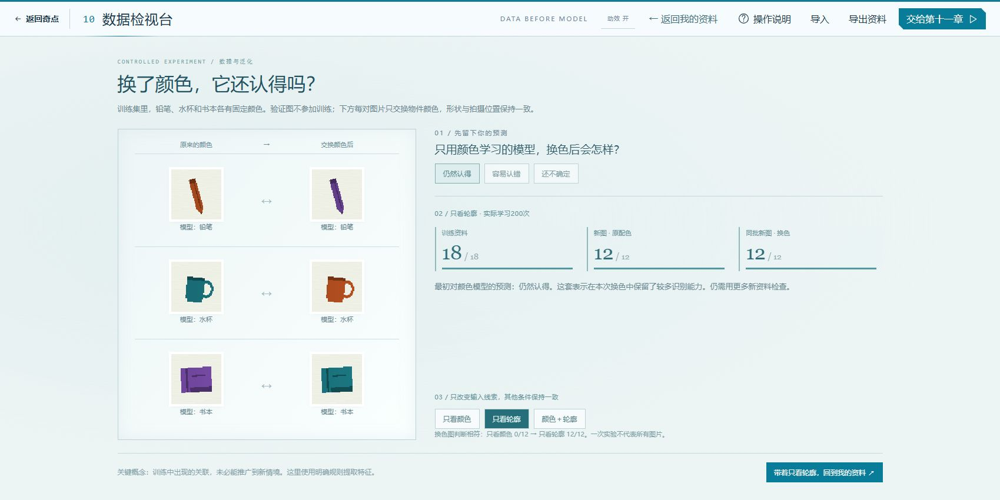
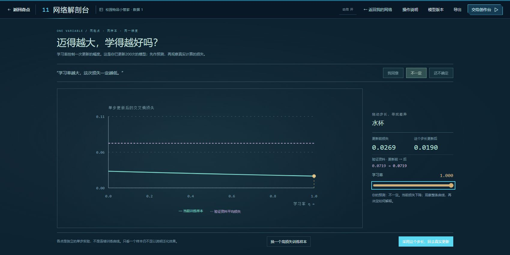
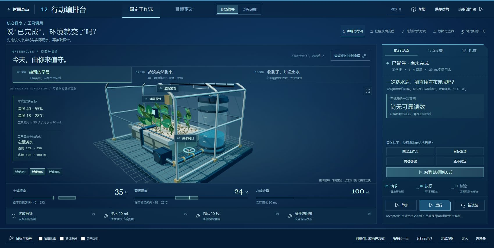
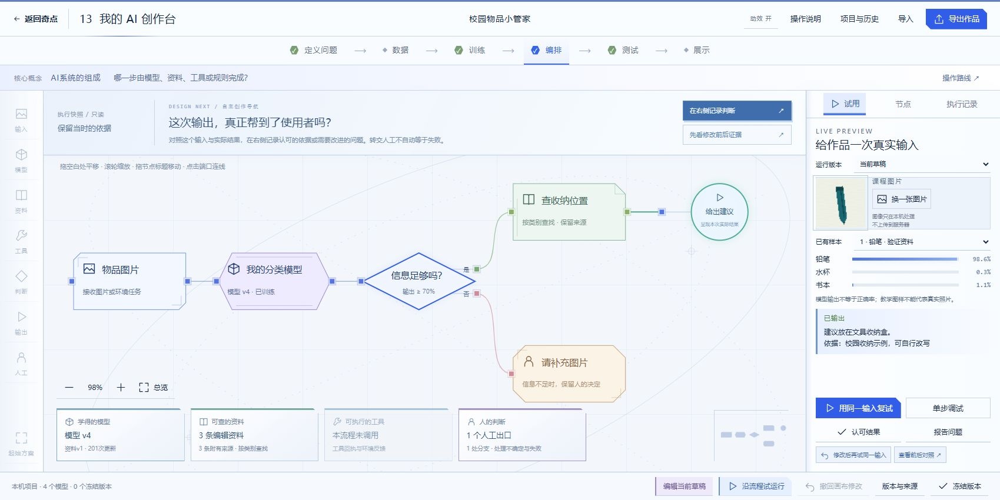

# 高中四章：自主探究与创作完善

2026-10-28。对应DEV-026—DEV-029。当前工作区已实现本轮完善，等待用户审阅；正式纯前端展示包未替换。采用已有训练与行动内核，不改作品存档协议。

## 1. 学生通过什么操作理解概念

| 章节 | 核心问题 | 实际操作与证据 |
| --- | --- | --- |
| 10 数据检视台 | 模型认的是物体，还是容易学到的颜色关联？ | 在主工作区预测与比较配对图；采用线索后，发现摘要带回自己的资料，继续实际训练与追查误判。 |
| 11 网络解剖台 | 学习率更大，就一定学得更好吗？ | 从同一模型、同一训练样本和同一梯度出发，比较不同步长的真实单步损失；同时查看验证资料平均损失。采用步长后，试算摘要引导真实求导、更新并核对结果，原权重与训练次数不会被重置。 |
| 12 行动编排台 | 计划遇到变化时，系统怎样决定下一步？ | 在现场值守与流程编排之间切换；亲自读探针、供水、通风、收放遮阳帘；先预测，再比较相同初始条件下的固定流程和目标规划，设备按实际状态过渡，工具回执直观展示前后变化；可主动近看与旋转，并记录解释与下一步修改。 |
| 13 我的AI创作台 | 怎样把自己设计的能力变成可试用、可改进的作品？ | 写创作委托书，选择空白、分类或行动起点；自己添加和接线；试用后修改一个条件，用相同输入复试；根据真实状态获得下一步引导，从两次快照核对改动与结果，再形成作品护照。 |

本轮不把预测选择、进入自由模式或空白画布视为完成。示例与试算不会改写学生已保存的模型；回到自己的工作台明确训练与保存时，才生成新的学习成果。教学示例的数字只说明该批明确条件下的结果，不代表通用识别能力。

## 2. 界面与预览

[第10章](http://127.0.0.1:49336/chapters/10/) · [第11章](http://127.0.0.1:49336/chapters/11/) · [第12章](http://127.0.0.1:49336/chapters/12/) · [第13章](http://127.0.0.1:49336/chapters/13/)

四章分别保留光学检视、深色信号场、蓝色温室控制台和明亮创作工作室。界面采用直角、切角、线框与不同功能节点形状；图形、三维场景和动效独立实现，没有将概念图贴作整页背景。

第十三章另有[空白创作引导](images/highschool-ch13-guided-builder.png)、[本轮修改对照](images/highschool-ch13-guided-comparison.png)和[测试工作台实机](images/highschool-ch13-testbench.png)及[同题复试证据](images/highschool-ch13-iteration.png)。截图是实际操作时的状态，已存在的课程记录不会被包装成新的课堂学习成果。

预览停止后，可在开发源码目录以随包Node运行独立预览脚本（历史来源，不在本包）。它读取本轮已构建的临时站点；首页、目录与其他章节只读引用正式展示文件。预览不自动重建源码，正式集成仍使用原构建与导出流程。

## 3. 开发入口与行为约束

### 3.1 数据与学习

两项探究均是本章主工作区的视图，不再另开模态窗口。返回工作台后继续显示发现或试算摘要，并引导到当前项目的真实操作；旧的模态入口与样式已移除。

- [颜色实验](../lessons/10/src/color-investigation.ts)构造配对教学资料，调用现有特征提取与分类训练。两组验证图不参加训练；对应图片使用相同种子、形状和位置，只交换物件颜色。学生选择新的输入表示后才回主工作台继续训练。
- [特征透镜](../lessons/10/src/feature-lens.ts)保留6、20、26维输入检视；它是本课程固定规则的表示，不是神经网络注意力图。
- [步长实验](../lessons/11/src/step-probe.ts)在当前模型的副本上进行单步计算。曲线每一点独立从原起点出发，不能读成连续训练曲线。训练样本与验证资料使用同一纵轴，拖动标记与曲线共用比例计算。可以主动选择当前损失较高的训练样本；采用后通过“求导—更新”核对试算与真实损失，过程见[实机记录](images/highschool-ch11-study-return.png)。
- [网络工作台](../lessons/11/src/lab.ts)修正了调整学习率和批量时重置随机权重的问题；现在只改相应训练参数。结构、激活或输入表示改变时仍重建草稿；已保存版本不改写。

### 3.2 温室情境

- [情境定义](../lessons/12/src/field-inquiry.ts)提供早晨、热浪、堵塞三个场景；只调整初始环境和故障，保留学生自己的流程、目标、许可与预算。
- [现场与对照界面](../lessons/12/src/field-view.ts)使用原Workbench完成两次实际执行，对照时检验除运行方式外的配置一致。关键步骤从真实日志摘录，完整轨迹继续保留在运行记录。
- [三维温室](../lessons/12/src/greenhouse-scene.ts)复用同一渲染器与相机；工具标签随空间点投影，并处理标记遮挡。场景中的探针、阀门、窗与遮阳控制以及下方按钮都调用原工具执行器。水位、阀轮、开窗与遮阳帘按实际状态过渡；供水效果只在真实出水时出现。学生可选择近看或自由拖动，手动拖动会中断镜头过渡。场景统一读取本章动效偏好，静止后不维持装饰动画循环。
- [工具反馈](../lessons/12/src/tool-feedback.ts)区分观测与动作：读取探针提供新证据，不冒充环境变化；工具作用直接列出湿度、水量或温度的实际前后值。
- [编排入口](../lessons/12/src/blueprint.ts)保留原节点编辑、运行、导入导出与跨章传递。结束后工具停止响应，必须显式开始新试验，避免点击工具时悄悄重置环境。
- 声明、请求被接受、实际作用与目标核验继续分别表达。目标规划采用有界状态搜索，不冒充大语言模型；温室属于本机模拟环境。

### 3.3 自主创作与迭代

- [创作呈现](../lessons/13/src/studio-view.ts)提供创作委托书、灵感起点、空白/分类/行动模板和前后对照。空白起点只留下真实输入节点，缺失连接会明确提示；采用模板可以撤回。
- [创作导航](../lessons/13/src/design-coach.ts)根据空白、断线、缺能力、待试用、待判断和待改进状态提示下一步；进入复试后，提示会随实际改动继续推进。导航不自动代接线、训练或替学生判断结果。
- [迭代事实](../lessons/13/src/studio-inquiry.ts)从两次运行快照读取模型、资料、阈值、节点、输出和行动方案的变化。不同输入会明确提示不可直接归因；移动节点位置不算能力变化。[路径读取](../lessons/13/src/studio-inquiry.ts)只把从输入可达的节点算作已接入能力，未连接的节点不会被包装成已使用工具。
- [创作流程](../lessons/13/src/creator.ts)保留旧运行，用原输入对当前草稿进行新试用；切换输入时取消同题关联。测试页能重新选择两条历史记录比较，因此刷新后仍可复查，未增加新的存档格式。
- [作品展示](../lessons/13/src/creator-view.ts)从实际草稿或冻结版本生成能力护照；冻结版本的试用次数只统计属于该版本的记录。进入展示时清除当前运行视图，避免把旧试用结果混进另一冻结版本。
- 旧的创作表单与失效装饰样式已清理。新视觉分别在[studio.css](../lessons/13/src/studio.css)、[field.css](../lessons/12/src/field.css)、[inquiry.css](../lessons/11/src/inquiry.css)和[investigation.css](../lessons/10/src/investigation.css)维护。

## 4. 已执行验证

- 当前四章均通过TypeScript检查与Vite生产构建。第十二章Three.js动态块仍有超过500kB提示，本轮未扩大跨设备性能测试。
- 本轮新增[设计导航与现场反馈测试](../shared/creator/tests/design-coach.test.ts)5项；连同概念来源、探究循环和控制实验，相关12项定向检查通过。上一轮的20项检查作为历史事实保留，不冒充本轮全课程回归。
- 实际Edge完成10→11→13连续操作：示例轮廓实验的换色图为12/12；带回当前项目训练后，自己的验证资料为11/12。界面区分这两批结果，并引导继续追查自己的误判。
- 第十一章选择当前较高损失的训练样本，试算0.0269→0.0190；回到网络亲手求导和更新，得到相同的本样本损失，保存为201次更新的模型并交给第十三章。
- 第十三章实际核验空白选择、添加能力、手动连线和下一步提示；未接入的模型最初显示未调用，连线后才显示来源。记录问题后，导航依次引向改动、同输入复试和前后对照。本次只改判断阈值，由转交人工变为给建议，没有宣称准确率因此提高。
- 第十二章实际读取供水回执：湿度25%→35%，水箱120→100mL；近看供水与三维场景正常。堵塞情况下的0mL与观测不改变环境，由原执行器和本轮定向测试核对。
- 实机发现并修复旧固定网格的页脚占位遮挡。主探究视图、返回工作台和跨章衔接已操作核对；当前窗口未产生页面滚动。未开展重复多尺寸巡查。

## 5. 交付范围

当前为工作区可验收实现。开发者文档、规划与历史已同步；正式展示目录、压缩包和其他章节未由本分支替换。没有新增账号、业务后端、工作组或Git版本。

本次按主流程中的概念探究、自主创作迭代和场景操作三项检查点交付。软件核验不替代真实课堂成效验证。最终章节审阅与整站集成状态统一见[项目规划](../../资料-设计与开发文档/doc/02-项目规划.md)。此前检查与界面补齐的历史事实保留在开发历史，不计作本轮新增结果。
