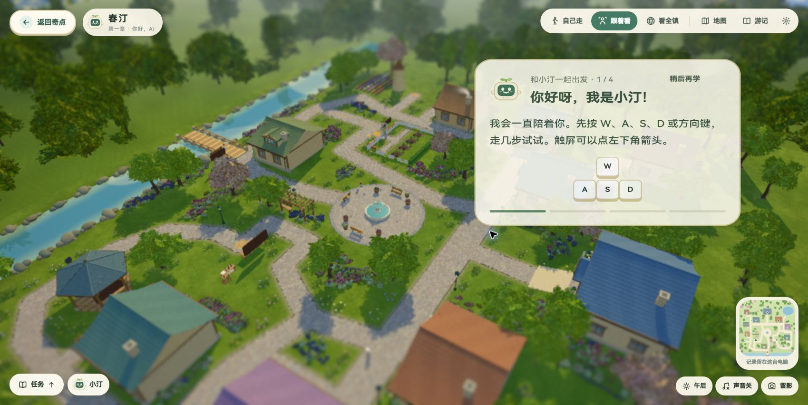
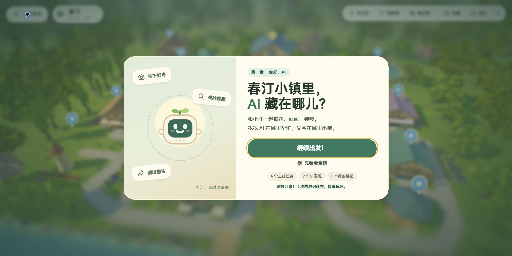
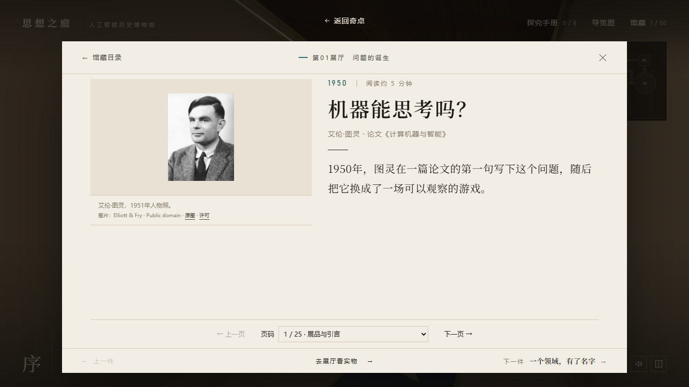
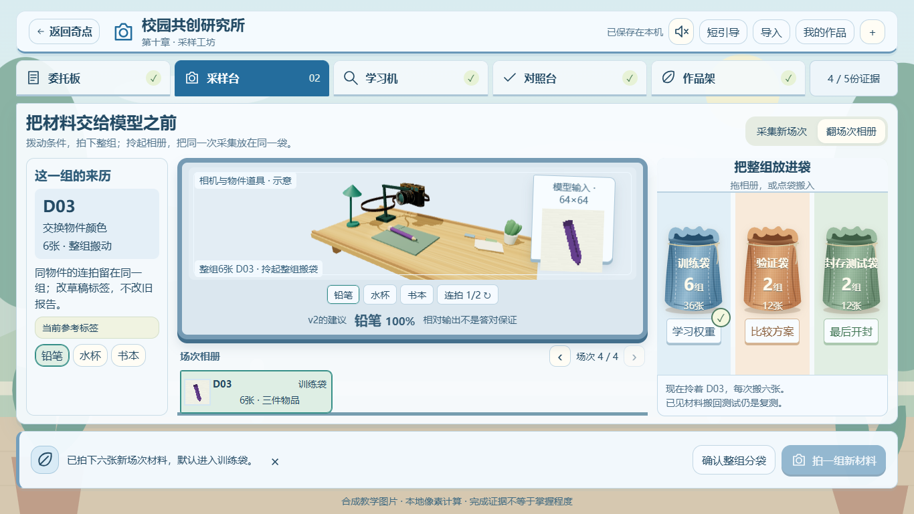
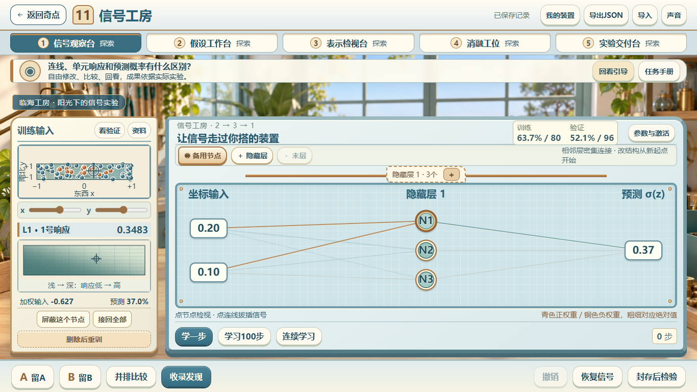
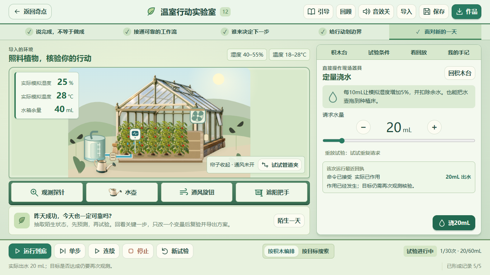
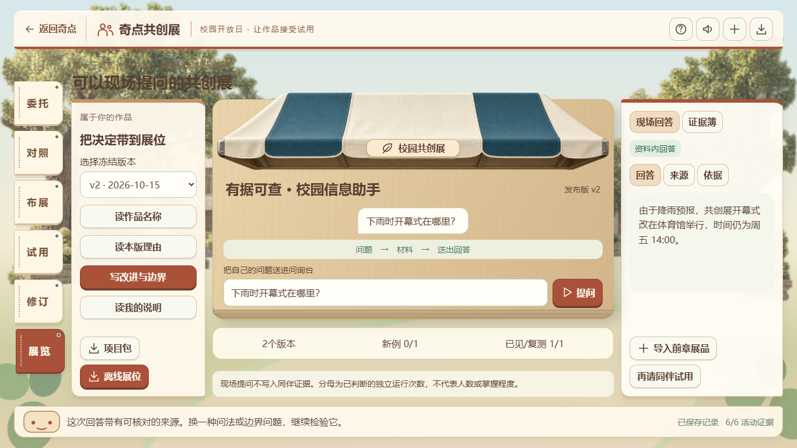

# 一小时补强：实际画面与核验

本页保留前序阶段证据。当前全章返回状态、无账号展示与压缩包结果以[纯前端交付](纯前端交付.md)为准。

2026-10-15，DEV-004。本页均为真实生产构建截图，未注入样式。

## 返回入口

2026-10-15后续修正：第一章返回按钮采用小镇原有的奶油色、绿色圆润按键，放回左侧顶栏，与品牌和右侧工具采用同一布局、遮罩及交互状态。聚焦引导时随整条顶栏变灰、模糊并暂停操作，进入小镇后恢复；不再用独立高层级覆盖聚焦界面。已重建第一章，并在实际Edge的1366×768与1440×900下检查引导、主场景和代表工作台，实点返回目录成功。验收器同步区分“入口模态框暂停背景操作”和“工作区返回被遮挡”，6项定向判定测试通过。

第二章恢复博物馆导览文字样式和顶栏排布；阅读弹窗的返回置于上方留白。第三章恢复森林纸质按钮，右上工具栏持久可见，并给工作台预留空间。38项专项检查、10次实际返回通过。

## 四种章节形态

第十章是蓝白采样调查台，突出相机、条件和三色资料袋。

第十一章是铜线信号工房，左侧观察输入和响应，右侧搭建网络；三起点结果补齐真实计算量和耗时。

第十二章以温室环境和灌溉工具为中心，行动积木保留独立工具区。

第十三章采用侧边展览路线和票签导航，保留可现场提问的展位。

## 真实补验

- 第6/11章各五单元，第7章核心8环节与自由出版，第8章全部25活动，第10/12章各五单元，第13章v1失败→同伴试用→v2复测均有真实操作证据。
- 完整单元检查924项通过；新的浏览器验收命令对缺页、失败资源、流程错误和返回失败返回非零状态，不再只写报告。
- HTTP局域网IP下真实注册、出版作品、模型指纹校验及另浏览器登录续学通过，测试未使用浏览器安全例外。UUID使用安全随机字节补齐；SHA-256仍严格校验，未绕过。
- 第一至五章的全部内容、真实学生试教和第二台物理电脑网络尚未穷尽验证。

[紧凑数据](../../资料-制作过程/整站-核验数据/本轮核验数据.json) · [全部验收边界](实际验收.md)

浏览器接口边界依据：[MDN randomUUID](https://developer.mozilla.org/en-US/docs/Web/API/Crypto/randomUUID)、[MDN digest](https://developer.mozilla.org/en-US/docs/Web/API/SubtleCrypto/digest)。实现与实测均未降低模型哈希校验或采用弱随机数。新增哈希依赖的[MIT许可](licenses/noble-hashes-MIT.txt)随工程保留。
