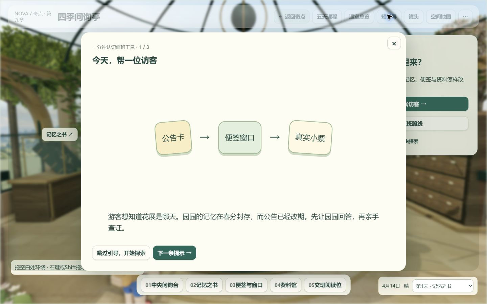
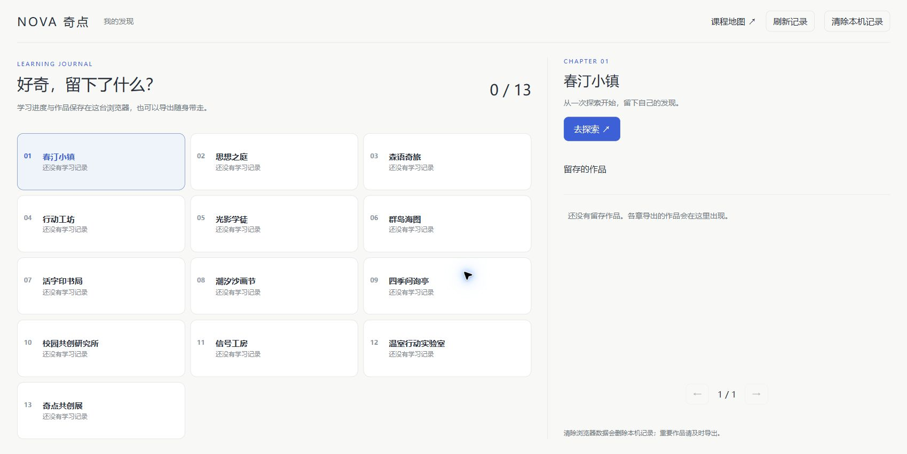

# 纯前端提交包与交付核验

## GitHub发布（2026-10-30）

[源码仓库](https://github.com/falling-feather/nova)的 `main` 分支保存源码，[在线站点](https://falling-feather.github.io/nova/)由 `gh-pages` 根目录发布。当前静态构建使用 `tools/static-site.cjs`，与Windows包共用组装逻辑；课程路径支持 `/nova/` 前缀。操作命令见[根README](../README.md)。下文保留此前本机整包的交付记录。

## 当前交付（2026-10-29）

- 奇点提交版.zip（历史来源，不在本包）：完整解压后双击“点我一键启动.cmd”，含首页、按阶段/按概念目录、十三课时、模型与全部运行素材，使用包内Node 24.20.0。
- 奇点完整源码-20261028.zip（历史来源，不在本包）：本轮源码、锁文件、素材与可编辑工程、设计和开发文档；不含node_modules、数据库及测试缓存。文件名标记本轮2026-10-28开发基线，实际封包于次日完成。
- 本次从当前源码统一重建全部十三章，依据各分支最新交付合并为新包，不复制旧展示包作为成品。旧“整站-纯前端展示”保留，防止覆盖原有展示和记录。
- 从ZIP解压到含中文与空格的新路径，实际运行包内CMD和Node；16个入口、471个静态资源及WASM类型通过，重复启动复用实例，账号接口返回404。压缩包通过ZIP CRC检查，未例行另算文件哈希。
- 本次交付检查（历史来源，不在本包）记录实际范围；没有重走各章全部教学活动、多尺寸界面巡查或第二台电脑测试。

## 维护命令

先运行npm run build，再以Node 24.20.0或更新版本执行 `node tools/export-frontend.cjs ../nova-windows`。输出目录须不存在，父目录须已存在且在总工作区内；不自动覆盖旧包。当前源码先运行 `npm run build:site`，再以 `npm start` 预览纯前端站点。Windows独立包使用其一键启动脚本。

## 历史交付记录（不代表本次重跑）

2026-10-16更新。当前参赛交付为总工作区中的奇点纯前端提交版.zip（历史来源，不在本包），解压后双击“点我一键启动.cmd”。第六章为分层航海图桌，第七章为A版通透展陈；第10—13章已更新为数据检视台、网络解剖台、行动编排台和AI创作台。当前包已加入科技风重绘与动态交互，散列和本阶段验证以[高中科技风核验](../../资料-制作过程/整站-核验数据/高中科技风核验.json)为原件；前阶段功能与待人工确认项保留在[高中四章核验](../../资料-制作过程/整站-核验数据/高中四章核验.json)；前次6/7验收保留在[海图与书局记录](../../资料-制作过程/整站-核验数据/海图与书局核验.json)。原开发源码仍在奇点提交版，55887端口提供纯静态网页。以下初次全章核验的数据保留2026-10-15日期，不冒充本次重跑结果。

前阶段全站单元检查949次执行通过，之后创作核心15项定向回归通过；本阶段新增重绘与动态交互由20项创作核心和34项行动内核定向检查覆盖。四章实际浏览器操作、两种桌面布局和四条返回路径已核对。完整作品包的编码校验、导入、刷新恢复和实际运行通过；浏览器连接器不支持Blob下载读回，未自动确认下载是否实际落盘。这一项在本机验收时点“保存完整作品包”确认即可。没有因此清空或覆盖旧学习数据。

## 返回按钮

第1—13章逐章实测，包含1366×768与1440×900两种桌面尺寸，共62个入口、工作区与聚焦状态，十三条返回路径均实际点击成功。返回控件唯一，未发现顶栏重叠、越界和页面滚动。

| 章节 | 采用的本章样式与状态 |
| --- | --- |
| 1 | 小镇奶油色圆润按键，随原顶栏进入遮罩背景 |
| 2 | 博物馆文字导览，不再把返回按钮移进阅读弹窗 |
| 3 | 森林纸片按钮，返回、声音、暂停在聚焦时一起变灰并暂停操作 |
| 4 | 木质工坊纸牌，纳入原顶栏，撤掉独立高层浮窗 |
| 5 | 暗房铜色控件，在顶栏占位，弹窗不再携带另一个返回入口 |
| 6 | 航海图桌的木质顶栏与文字控件，原生阅读窗口统一遮罩 |
| 7 | 通透展陈的文字导航与细线控件，原生模态遮罩 |
| 8 | 海岸文字导航，恢复纸质弹窗原有遮罩 |
| 9 | 温室绿色按键，整条顶栏随引导变灰，键盘不再绕到返回按钮 |
| 10 | 冷白光学检视、切角样本与真实像素探针，原生模态遮罩覆盖整条顶栏 |
| 11 | 深色神经信号场、真实响应圆环与青蓝/暖金光流，原生模态遮罩 |
| 12 | 蓝色正交工程线路、可点击探针与水阀，阅读弹窗使背景共同变灰 |
| 13 | 明亮概念画布，六边形、菱形、圆环等语义节点，返回纳入原生模态背景 |

页面内短提示不阻断整条工具栏；需要聚焦的模态窗口才统一暂停背景操作。第10—13章的当前教学、计算和成果流转以[技术手册9.4](../../资料-设计与开发文档/doc/01-开发者文档.md#94-高中四章与贯通创作)为准。

## 纯前端范围与数据

本包保留首页、课程目录、十三课时、本机学习进度、原章导入导出与作品留存。“我的发现”直接读取当前浏览器记录，没有登录、注册或账号同步。用户此前确认的账号方案已由本次纯前端交付要求覆盖。

静态启动器只提供网页、模型、WASM、图片和视频等文件；账号接口返回404，不启动数据库。随包携带Windows x64 Node.js 24.20.0及许可证，不依赖开发目录、系统Node或npm安装。课程内容可将site/原样部署到静态站点根目录。

2026-10-15初次切换时，旧正式数据库及WAL/SHM文件已删除，正式站点55887和测试站点5394的指定浏览器记录已清除，当时显示13章均无学习记录、0件作品。2026-10-16本轮没有再次清除记录；旧成果按当前迁移规则保留。此前下载的文件也继续保留。

## 初次纯前端交付的验证（2026-10-15）

- 十三章生产构建通过；后续定向重建也通过。源码完整测试930项通过。
- 纯前端包与当前课时构建逐文件核对一致，仅入口增加本机存档脚本，并排除无用的.gitkeep占位文件。
- 最终ZIP重新解压后，456个文件逐字节校验一致；443个站点资源的HTTP访问及WASM类型检查通过。未携带数据库、服务端账号代码、node_modules、日志或运行提示文件。
- 在含中文与空格的新解压路径中实际运行“点我一键启动.cmd”，使用包内node.exe成功启动；重复启动退出码为0，复用同一服务进程。浏览器自动打开首页成功；同时修复首页“我的发现”链接的点击样式，已实点进入空白本机记录页。
- 第13章导出操作产生的作品能在独立的本机发现页重新看到；清除后恢复空白。正式本机页仅请求静态文件，没有账号接口请求。
- ZIP大小351,386,679字节；SHA-256：`31217b58d7aa6f97477cb55b1ae806dcc534a24e221e256c4da5c062684292ef`。

本轮重点验证导航、聚焦、纯前端存储与独立打包，没有重新完成每章全部学习活动。真实课堂试教、第二台物理电脑的性能及局域网防火墙仍需现场确认。逐项数据见[纯前端验收数据](../../资料-制作过程/整站-核验数据/纯前端验收.json)。

## 维护入口

[导出器](../tools/export-frontend.cjs)从当前生产构建生成交付文件夹，已有目录时拒绝直接覆盖；[独立包核验器](../tools/verify-frontend.cjs)检查文件一致性、静态资源和账号接口缺席。[本机存档客户端](../shared/linkage/local-client.js)复用原章节键、进度协议和作品格式。

先构建再导出；确认旧交付目录归属并妥善处理后，运行`node tools/export-frontend.cjs`。不要直接编辑生成后的site/作为源码原件。
