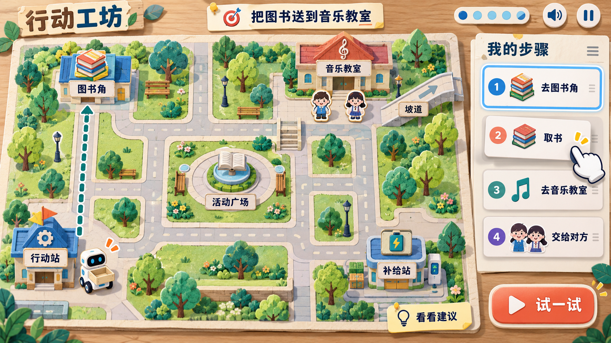
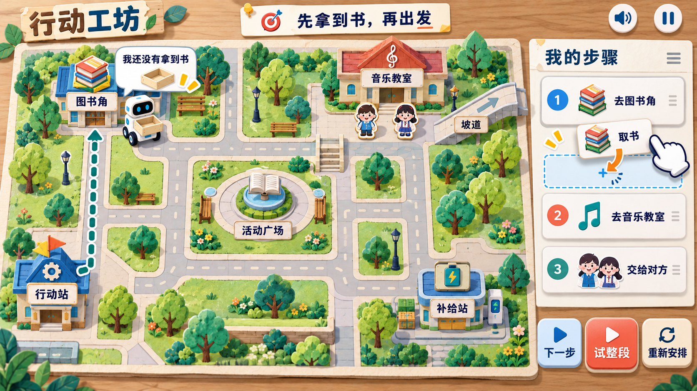
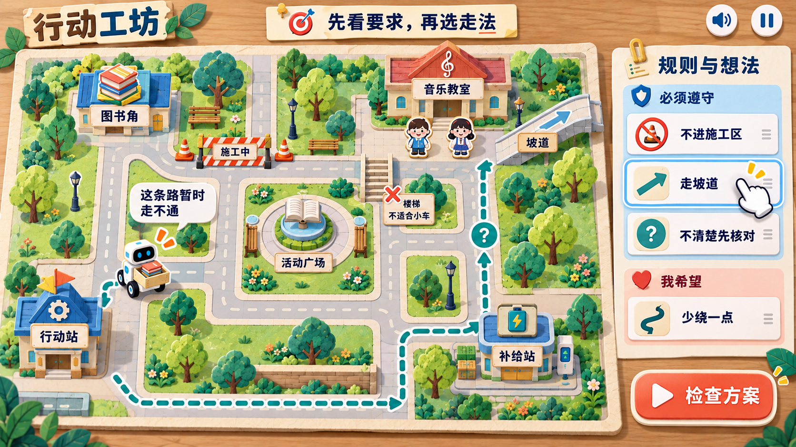
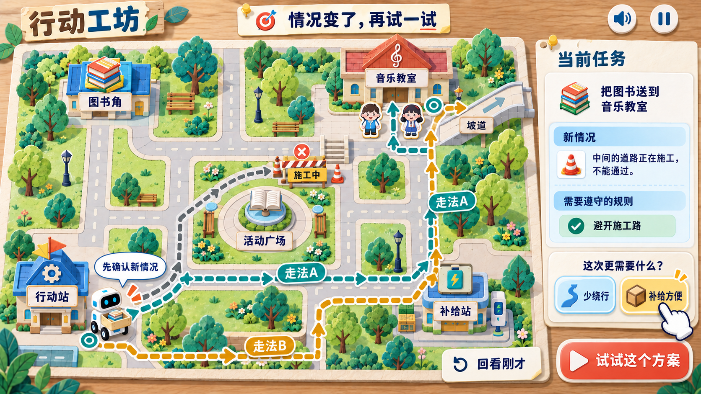
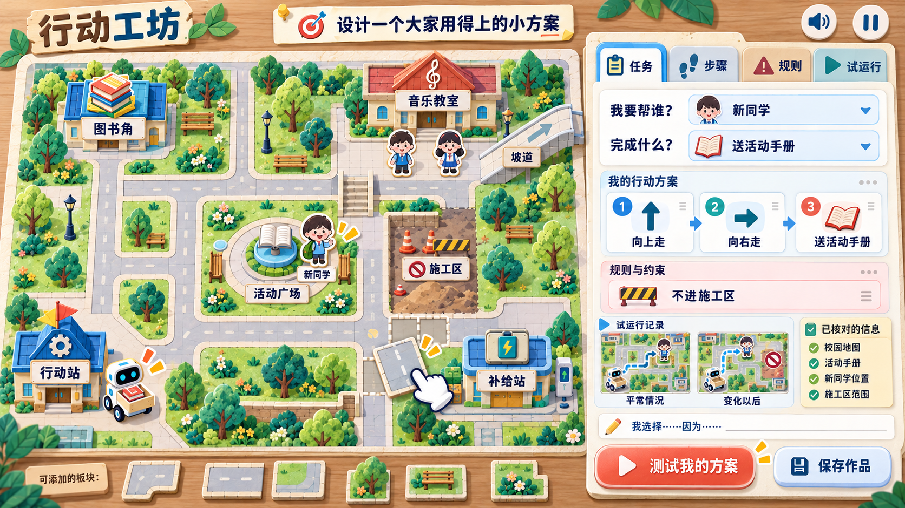
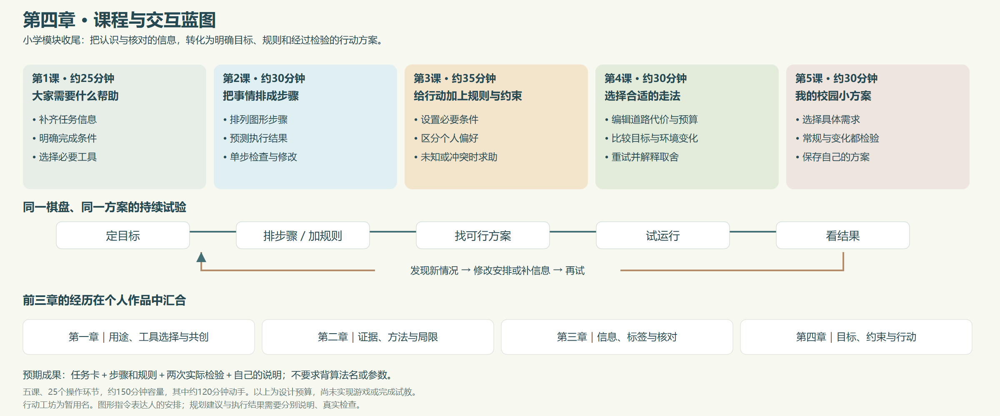
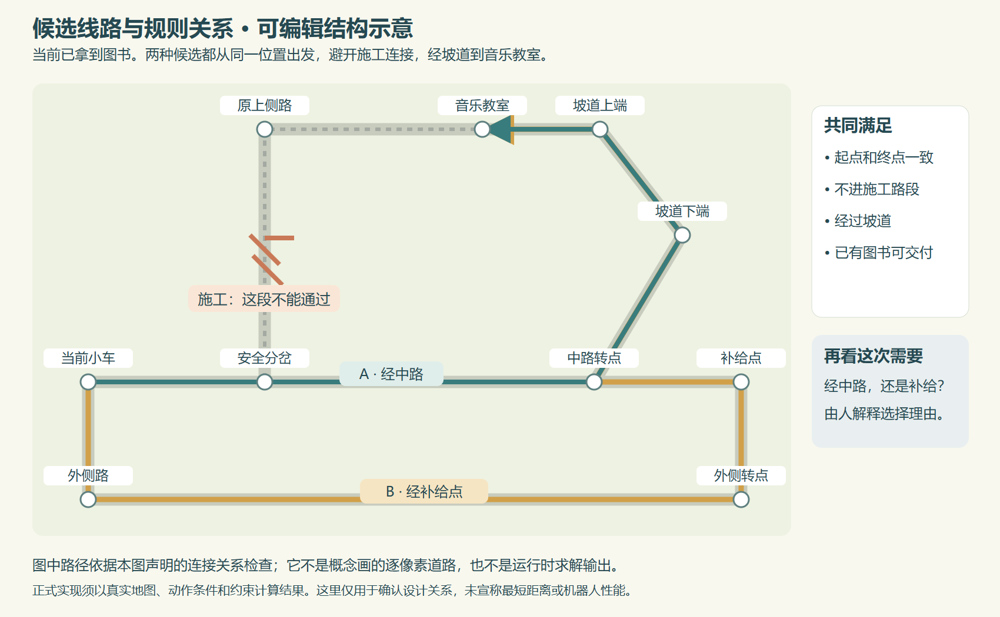
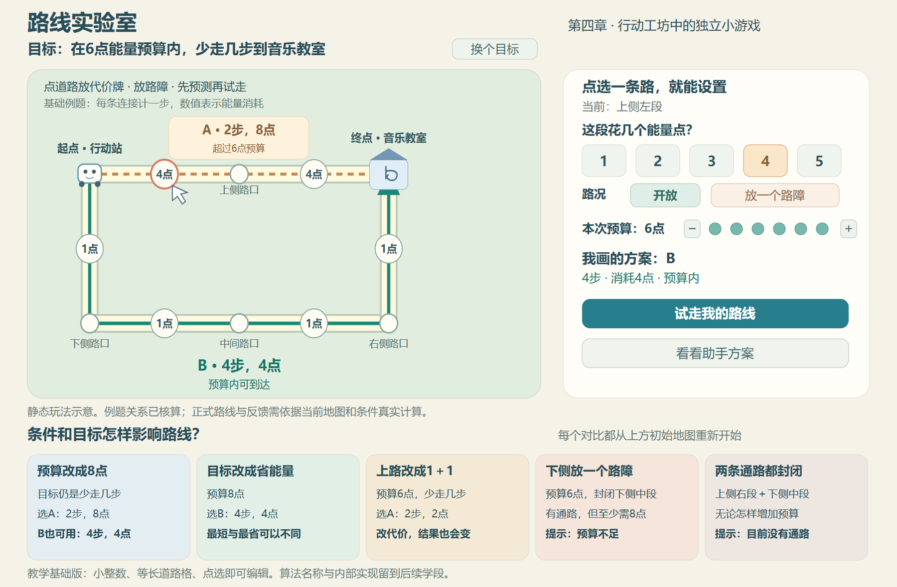

# 第四章行动工坊概念图集

日期：2026-10-03。主方案暂为2D俯视校园棋盘、图形步骤卡与试运行，游戏名称“行动工坊”也是暂用名。这里用五张游玩画面和课程、线路、路线实验室三张示意图，共八张图说明交互。尚未实现游戏，也没有实际求解或学生试教结论。

课程设计原件见[第四章说明](../../README.md)。建议先看01理解主玩法，随后按02至05查看步骤、规则、变化与个人项目；06说明课程关系，07说明线路条件，08展示本轮补入的逐路赋值、预算与封路玩法。

| 图号 | 画面 | 重点 |
| --- | --- | --- |
| 01 | 校园行动棋盘 | 人提出任务、排步骤，再请伙伴提供建议和试运行 |
| 02 | 单步试运行 | 观察遗漏动作，插入必要步骤，重新检验 |
| 03 | 规则与约束 | 必须条件、偏好、封路与坡道需求 |
| 04 | 环境变化 | 旧方案失效时停下，核对、比较与复验 |
| 05 | 我的校园小方案 | 自选需求、组合安排、两次检查与个人说明 |
| 06 | 课程与交互蓝图 | 五课、25个环节以及小学模块的综合收尾 |
| 07 | 候选线路结构 | 同一起终点、封路与坡道条件，两个不同的可行安排 |
| 08 | 路线实验室 | 编辑道路代价与路障，比较预算内少走几步与少花能量 |

## 01 校园行动棋盘

同一棋盘上的地点与道路提供可改变的教学环境。孩子用“去图书角、取书、去音乐教室、交给对方”等卡片表达自己的安排，再通过建议与执行检查结果。相同地图后续加入新的对象、条件和需求继续使用。

## 02 图形步骤与单步试运行

当前方案漏了“取书”。孩子看到小车空手到达，插入必要动作，再单步或整段尝试。运行必须反映当前状态和动作条件，不是播放固定成功动画。

## 03 规则与约束

施工路与通行要求限制可用路线；必要条件与“少绕一点”等偏好分别呈现。未知资料先核对，固定场地条件不能为了通关任意删除。

## 04 新情况与重新选择

旧路线在环境变化后需要重新检查。多个满足条件的方案可以依据需求选择，课程接受有理由的不同取舍。概念画着重表现美术、选择和反馈界面，彩色线路不充当精确道路几何；本例的完整连接与必要条件另见07。正式游戏结果需真实搜索和条件校验。

## 05 我的校园小方案

孩子选择服务对象、必要信息、步骤和规则，进行常规与变化下的检验，再保存自己的说明与可回玩的方案。图中记录是界面示例，正式作品来自孩子实际操作与表达。

## 06 课程与交互蓝图

[打开可编辑SVG](06-课程与交互蓝图.svg)。课程依次从目标澄清进入步骤、约束、方案取舍与个人设计。五课共约150分钟，包含约120分钟动手操作，均为待试玩校准的预算。

## 07 候选线路结构

[打开可编辑SVG](07-候选线路结构.svg)，[查看节点与连接数据](07-候选线路结构.json)。本例从“已取到书”的当前状态开始，两条候选从同一小车位置到达同一音乐教室，均经过坡道且避开已封闭的连接；一路经过中路，另一路经过补给点。颜色表达可比较的候选，不表示两条方案已经经过实际游戏检验，也不宣称其中一条最优。

这是独立的教学结构图，用于明确路线之间的关系。它不复刻概念画的精确比例、路面宽度或碰撞边界；正式地图需依据最终布局重新生成连接和验证。

## 08 路线实验室

[打开可编辑SVG](08-路线实验室-玩法示意.svg)，[查看可核算的例题](08-路线实验室-教学例题.json)。学生点选路段放代价牌、放置路障、设预算，再手画路线、试走并比较助手候选。上侧两段各4点，下侧四段各1点；图中的点数、路段数与对比情境来自同一例题数据。

这张图专门说明独立小游戏的操作和条件关系，美术可沿用01的纸艺校园。它采用简化的近邻地图，并非07的同一张道路图。完整机制、八轮实验与课时安排以[第四章设计](../../README.md)为原件，实验约38分钟已包含在原有150分钟中。

示意图是静态设计，不支持点击操作，也不是规划服务的真实运行输出。例题核算只验证图中数学关系，不代替未来游戏中的寻路、状态更新与课堂试玩。

## 科学性与当前边界

图形指令表达人的安排；自动动作、规则校验与界面功能可以是普通程序。规划伙伴要在受限任务中真实寻找、检查候选，不把所有自动化称作AI，也不把“有规则”与“有AI”当作互斥。

未知、冲突、暂停和求助可以成为合理结果。模型或求解能力、场地规则、人物信息和简化资源条件都应明确；本轮没有控制真实机器人或收集真实学生资料。

五张概念画使用内置Image Gen，02至05参考01保持视觉和棋盘一致，04另进行一次线路连贯性编辑。完整提示词、参考输入与最终文件信息见[生成记录.json](生成记录.json)。06为手工绘制SVG，07与08依据各自的数据绘制为SVG，三图均通过本地浏览器导出PNG。
