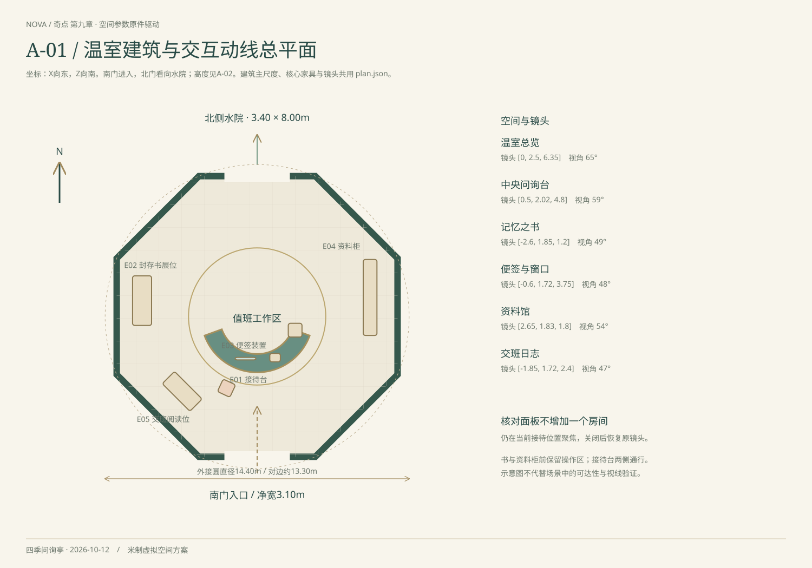
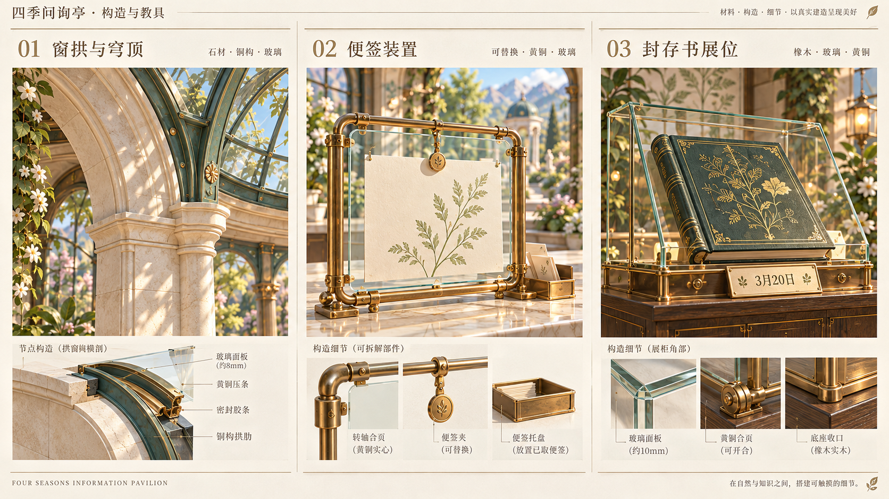

# 四季问询亭空间与交互设计

课程的核心问题是“这次回答使用了什么信息，凭什么可以相信”。整个温室围绕这个问题组织：中央接待，左侧理解记忆，桌面准备便签，右侧查找资料，西南回顾交班。工作站属于同一空间，当前问题贯穿所有操作。

## 视觉与结构

第一章提供细腻的植物、柔和的角色塑形和生活尺度；第二章提供真实建模、可追溯材质、环境遮蔽与明确的展陈秩序。对应参考保存在 [references](references)，新增深化图保存在 [concepts](concepts)。生图只用于确定效果目标，运行时没有裁切概念图充当家具、按钮或整页背景。

建筑采用八角平面，南门进入，北门通向水院。穹顶、柱拱、接待台、封存展柜、资料柜及交班桌均由几何构建。玻璃、铜边、木作、皮面和正文分别处理；花藤与树木使用三维枝干、弯曲叶片和专门制作的透明枝叶图集。

主要尺度与镜头只在 [plan.json](../src/spatial/plan.json) 维护。图纸由 [draw-plan.mjs](../tools/draw-plan.mjs) 生成，不在这里重复维护坐标表。

## 一次问询如何完成

1. **总览到接待台**：总览只解释今天从哪里开始；接待时保留一个游客问题和一个主要动作。
2. **选择信息来源**：凭记忆可直接回答；便签和资料把镜头带到对应装置。准备材料后回到原问题。
3. **生成回答**：园园逐词生成。过程中可以停止；完成后再提供核对入口。
4. **核对依据**：浮窗并排呈现回答与课程原文，背景柔化。学生选择自己的判断后才写入日志，模型概率与事实判断分别呈现。
5. **回顾交班**：手册保留问题、答案、实际送入的便签和资料原文快照，以及学生判断。后来改动资料不会改写旧记录。

“资料匹配分数”“实际送入页码”和“事实正确”是三件不同的事。界面不把检索成功画成正确答案徽章，也不把生成概率标为正确率。

## 镜头与阅读层

总览保留空间全貌，接待近景沿南北主轴接近柜台。书、便签、资料与交班桌有可自由观察的聚焦起点；打开右侧阅读层时画面向左让出空间。窄屏把阅读层放在下部，接待镜头聚焦园园，底部工作站始终可达。

阅读正文使用浏览器原生文本。玻璃便签上的字是短摘要，完整材料在阅读层查看。背景透明度只用于装饰和环境提示；主要按钮和正文有稳定底色。核对窗口捕获键盘焦点，Escape 关闭并返回触发按钮；减少动态模式直接切换镜头。

## 可编辑部件

| 层次 | 制作与职责 | 当前入口 |
| --- | --- | --- |
| 空间参数 | 建筑主尺度、核心家具、相机和路线 | `src/spatial/plan.json` |
| 建筑与水院 | 柱拱、玻璃穹顶、地面、水池、花境 | `src/scene/architecture.ts` |
| 教具 | 柜台、玻璃框、封存书、抽屉柜、阅读桌 | `src/scene/exhibits.ts` |
| 角色 | 骨骼人物、独立头部与脸屏的园园 | `characters.js`、`exhibits.ts` |
| 材质与细节 | PBR 材质、可编辑 SVG 烫金、程序皮纹 | `materials.ts`、`public/art` |
| 阅读与操作 | 原生文字、输入框、核对弹窗、导出手册 | `src/ui` |
| 课程事实与推理 | 输入构建、检索、实时推理、判断与存档 | `src/core`、`src/content` |

静态几何按材质及阴影属性合批，活动角色和拾取代理保持独立。资料柜目前有可识别的二十四个抽屉外观，资料操作通过阅读层完成；逐个抽屉拉开、传送管内纸条移动尚未实现。

## 二十五课的空间映射

以下课程已接入新工程。教学文本和完成条件由本工程的 [lessons.ts](../src/content/lessons.ts) 维护，工作台实际事件经 [lesson-session.ts](../src/core/lesson-session.ts) 进入 [journey.ts](../src/core/journey.ts)。每课保留独立的步骤和证据，选做跳过与完成分开记录。

| 园历 | 环节 | 主要空间与完成证据 |
| --- | --- | --- |
| 第一天 记忆之书 | 01 第一位游客；02 记得牢与记不清；03 封存之后；04 看看墨迹；05 该不该相信 | 接待台与封存书。保存多次真实回答、概率查看和学生核对，不以打开面板代替完成判断。 |
| 第二天 便签窗口 | 06 贴一张便签；07 下一位游客；08 书改了吗；09 贴错了；10 便签与记忆打架 | 接待台和便签架。对比加便签、清空便签和错误便签，参数指纹保持不变。 |
| 第三天 窗口就这么大 | 11 数一数格子；12 挤出去了；13 写短一点；14 放在哪儿；15 值一段早班 | 便签近景。真实输入格数、被移出的材料、摘要选择和位置对照实验。 |
| 第四天 资料馆与传送管 | 16 建资料柜；17 传送管；18 改一页；19 找错了、资料错了；20 没找到就说没找到 | 资料柜与接待台。检索候选、实际送入原文、修改前后答案和缺失资料的处置。 |
| 第五天 值班一天 | 21 排队的游客；22 突发通知；23 进修班 选做；24 值班日志；25 交班 | 三种信息来源与交班桌。分流决策、午后公告、训练对照、可回看的作品和交班理由。 |

课程路线只在需要引导、实验和小测时展开；日常问询仍以游客问题、园园和一个主要操作为主体。入柜、贴签、修改、生成、核对与转交均记录实际结果。游客使用第一章同源的骨骼人物，按学生、老人和成人身份切换；园历会改变采光，第五天使用阴天光照。进修班展示已有训练账单，未在浏览器中执行微调。

本版的传送管与抽屉为可编辑几何，资料操作由实体抽屉、场景原文纸页与同屏控制区完成。当前抽屉点选会拉开对应前板，纸条沿管道移动、室外雨滴和录音对白不属于已实现表现；不能把概念图的精细程度或完整动效当作当前实景截图。
